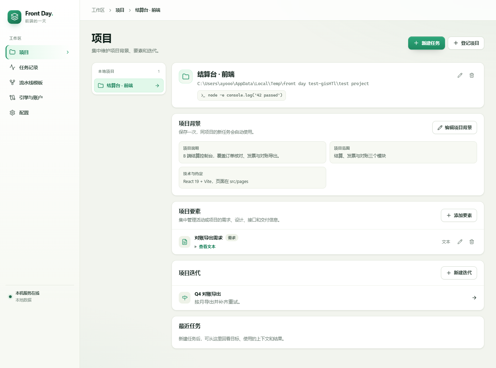
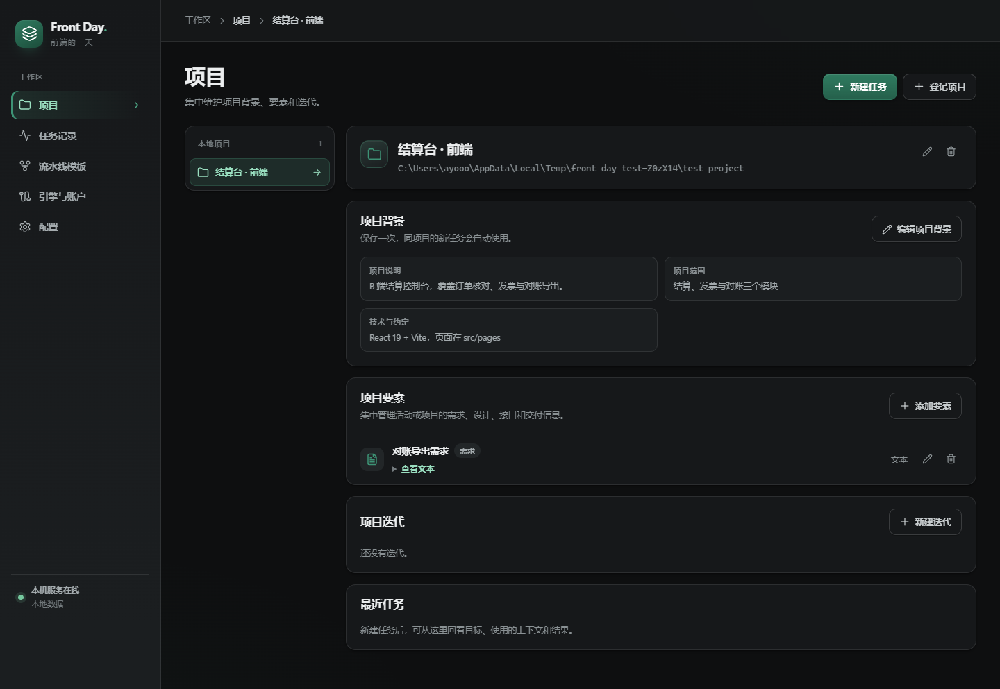

# Front Day

Front Day 是面向前端工程师的**本机项目知识库 + Agent 工作台**。项目维护通用背景，迭代维护一组有明确范围的需求；执行任务时，工作台把项目背景、迭代信息、任务补充和关联要素组装成上下文交给本机 CLI Agent，并记录完整的执行过程。

- 全程只监听 `127.0.0.1`，数据保存在本机 SQLite，无需云端账户。
- 支持 Cursor、Codex、Claude Code、GitHub Copilot、OpenCode 五套本地 Agent。
- 单页应用 + 单进程服务：服务端直接运行 TypeScript（Node.js 24），无需单独构建后端。

## 快速开始

需要 **Node.js 24+** 和 **pnpm**。

```powershell
pnpm install
pnpm dev
```

浏览器打开 <http://127.0.0.1:4317>。生产运行：

```powershell
pnpm build
pnpm start
```

### 环境变量

| 变量 | 默认值 | 说明 |
| --- | --- | --- |
| `FRONT_DAY_PORT` | `4317` | 服务端口，只绑定 `127.0.0.1` |
| `FRONT_DAY_DATA_DIR` | `<项目>/.front-day` | 首次启动使用的数据目录 |
| `FRONT_DAY_PREFERENCES_FILE` | `<项目>/.front-day.preferences.json` | 偏好文件路径，可为另一实例指定独立文件 |
| `FRONT_DAY_BROWSER` | 自动查找 | 浏览器测试使用的 Chrome / Edge 可执行文件 |

> 更新代码后需要**重启服务**（`pnpm dev` 的进程不会热更新服务端代码）；只刷新页面可能仍连着旧后端。

## 功能概览

- **项目与迭代**：登记本地项目目录，维护项目背景（范围、技术约定、限制、验收）与项目要素；迭代补充本次范围的需求、设计、接口、参考等。
- **要素（资源）**：文本、URL 或本地文件；URL 可开启「任务开始时读取内容」，支持 Basic / Bearer / 自定义请求头账户；可填写「说明」作为交给 Agent 的解析要求。
- **任务**：填写目标即可执行；可选任务类型、补充信息和流水线模板；支持直接执行或分阶段执行。
- **运行详情**：实时消息、工具调用、测试结果、任务上下文、原始协议事件；支持审批、回复、补充消息、停止、重试、归档与续改。
- **流水线模板**：内置前端交付、需求整理、Issue 概览、Issue 修复、问题分析、实施计划；可自由编排 Agent 与测试阶段。
- **引擎**：自动发现本机 CLI，检查协议与认证状态；支持自动选模与多种授权模式。
- **账户**：集中管理 HTTP 资源账户与提示词优化的厂商密钥，密钥在本机加密保存。
- **外观**：跟随系统 / 浅色 / 深色，保存在本机偏好中。

## 界面预览

| 项目页 | 任务详情 |
| --- | --- |
|  |  |

| 深色模式 | 账户与提示词优化 |
| --- | --- |
|  |  |

## 使用流程

1. **登记项目**：在「项目」页选择本地目录并确认工作目录；可以用地址栏快速跳转。
2. **补充项目背景**：在「项目背景」填写项目说明、范围、技术约定、限制与验收；保存一次即可被同项目的新任务复用。
3. **登记项目要素**：按需求、设计、模板、参考、接口、开发约定、测试、验收、发布与交付分组，也支持自定义类型。项目内文件用相对路径关联，项目外文件用本机绝对路径。
4. **创建迭代**：填写名称与说明，按需添加迭代要素；迭代任务会同时带上项目与迭代两层信息。
5. **新建任务**：填写目标并选择任务类型；可在「执行设置」指定 Agent、授权模式或流水线模板。默认由工作台自动选择本机可用引擎。
6. **跟进执行**：任务详情实时显示消息与工具事件；涉及权限、提问、计划确认时进入等待状态。等待人工放行的阶段可确认后继续。
7. **归档与回看**：「任务记录」支持按项目/迭代分组与筛选；归档任务保留执行记录与上下文，正在运行的任务会继续执行。

### 任务类型

| 分组 | 类型 |
| --- | --- |
| 梳理与实现 | 需求整理、功能开发、设计还原、接口联调、移植 |
| 维护与验证 | Bug 修复、重构优化、测试验收 |
| 其他 | 自定义类型 |

类型会作为执行指引写入提示词；留空时由 Agent 根据目标判断。

### 上下文如何组装

每次执行按以下顺序组合，并写入任务事件「发送给 Agent 的任务上下文」：

1. 任务目标与任务类型指引；
2. 本次任务的补充信息（范围、需求、限制、参考、预期输出、其他补充）；
3. 项目背景与项目要素、迭代说明与迭代要素；
4. 要素的 `content`、配置者填写的说明（`prompt`）与所绑定账户说明（`accountUsage`）；
5. 阶段要求（流水线）与上一阶段结果；
6. 资料索引：Agent 可按条目 ID 通过 `/api/runs/:id/context/:entryId?stage=N` 读取全文；
7. 通用执行约束：区分事实与假设、缺资料从工作目录补齐、保持范围与契约。

## 流水线模板

模板由一组有顺序的阶段组成，每个阶段可以是：

- **Agent 阶段**：指定引擎、运行模式、阶段提示词、使用的要素（全部或指定条目）；Agent 阶段可使用上一阶段结果。
- **测试阶段**：执行项目或阶段自己的测试命令，按真实退出码判定成功；可勾选由 Agent 以只读模式解读测试日志。

每个阶段可设置「成功后自动继续」或「等待人工放行」。阶段失败时可重试当前阶段，重试默认读取最新的项目、迭代和要素，也可沿用上次快照。同一任务各阶段共用工作目录。

内置模板：

| 模板 | 阶段 | 用途 |
| --- | --- | --- |
| 前端交付 | 需求分析 → 前端开发 → 测试验证 | 常规前端需求交付，需求分析后人工放行 |
| 需求整理 | 需求梳理 → 开发文档 | 把资料整理成可直接指导开发的 Agent 文档 |
| Issue 概览 | 读取与提取 → 分类与排序 | 汇总 bug 列表，输出分类、优先级与置信度 |
| Issue 修复 | 定位与复现 → 修复与自测 | 针对指定 issue 定位并完成最小修复 |
| 问题分析 | 收集线索 → 根因与方案 | 排查问题，给出根因、方案对比与回归清单 |
| 实施计划 | 范围与依赖 → 实施计划 | 针对特定需求给出可执行的实施计划 |

内置模板在首次初始化时写入，并通过一次性迁移补齐既有数据目录中缺失的模板：只补齐缺失的 ID，不覆盖已编辑的同名模板，删除后也不会在下次启动时自动恢复。

## 接入本机 Agent

工作台先从 `PATH` 和常见安装目录查找 CLI，也可填可执行文件绝对路径。进入页面只做文件发现，点击「检查连接」才启动协议与认证诊断，并给出可复制的终端命令。

| 引擎 | 接入方式 | 登录命令 |
| --- | --- | --- |
| [Cursor](https://cursor.com/docs/cli/reference/authentication) | `agent acp` | `agent login` |
| [Codex](https://developers.openai.com/codex/app-server) | `codex app-server` | `codex login` |
| [Claude Code](https://github.com/agentclientprotocol/claude-agent-acp) | `claude-agent-acp` 适配器 | `claude auth login` |
| [GitHub Copilot](https://docs.github.com/en/copilot/reference/copilot-cli-reference/acp-server) | `copilot --acp --stdio` | `copilot login` |
| [OpenCode](https://opencode.ai/docs/cli/acp/) | `opencode acp` | `opencode auth login` |

- 认证沿用对应 CLI 在同一系统账户下的登录状态。另一终端已登录但工作台未识别时，先核对 CLI 路径、`CODEX_HOME` 与启动终端的环境变量。
- Windows 上会透传显式配置的 `CODEX_HOME`，或当前用户已有的 `~/.codex` 目录；连接检查、任务执行与终端指引使用同一目录。
- 默认模型留空即沿用 CLI 设置；Cursor 另支持 Auto（由 Cursor 自动选模）与自定义模型 ID。
- 授权模式：手动确认 / 自动允许本次操作 / 自动拒绝。自动模式只处理引擎发来的工具权限请求；提问、计划确认与阶段放行仍需人工处理。
- 自动派发优先选择「已连接且认证就绪」的引擎，其次尝试「已建立会话、认证待确认」的引擎；手动指定的引擎优先于自动选择。
- 部分引擎只能确认 ACP 会话已建立，模型实际可用性需执行任务验证。

## 账户、凭据与资源读取

- 「账户」页管理 HTTP 资源账户：Basic、Bearer、自定义请求头；账户与 URL 的协议、主机和端口必须一致。
- 凭据来源二选一：**本机加密保存**，或读取启动终端里的**环境变量**（填写变量名即可）。
- 可为账户填写「说明」，在读取绑定资料时作为 `accountUsage` 一并交给 Agent。
- URL 资料开启「任务开始时读取内容」后，执行时按需读取：只接受 `text/*`、`application/json` 等文本响应，单个响应最大 **96 KB**，超时 15 秒，禁止重定向；内容中出现的密钥会被替换为 `[REDACTED]`。
- 密码使用 AES-256-GCM 加密，密钥文件为数据目录下的 `workbench.sqlite.key`（权限 0600）。备份账户时必须连同 `workbench.sqlite` 与 `workbench.sqlite.key` 一起保留。
- 每个本地账户可绑定环境变量名；启动任务时这些变量会从 Agent 与测试子进程的环境中剔除。

## 提示词优化

在「账户 → 提示词优化」启用，选择厂商与模型并保存 API Key；启用前必须保存 Key。

- 支持 DeepSeek、OpenAI、Anthropic Claude、Google Gemini、xAI Grok、Mistral、通义千问、豆包、Kimi、智谱 GLM、MiniMax；也可填自定义模型 ID。
- 模型与 API Key **按厂商分别保存**，切换厂商不会丢失其它厂商的配置。
- 新建任务时点击「优化任务目标」才会发起请求，只发送任务目标文字和任务类型，最多 12000 字符，超时 20 秒；优化稿需人工确认后才应用。

## 续改与交接

已完成任务可点击「继续修改」创建带来源链接的新任务：

- **自动选择**：根据引擎、工作目录、历史大小与背景差异选择续接原会话或使用交接摘要。
- **续接原会话**：要求同一工作目录、引擎、模型与运行模式，且直接执行（不用流水线）；只发送新目标与资料差异（上下文变化以摘要戳比对）。
- **用交接摘要开启新会话**：把已完成改动、关键约束、相关文件、验证结果四项摘要作为新会话的背景。
- 会话过长、已有后续任务或无法恢复时会自动回退到交接摘要；执行时也可手动指定方式。

## 并发、停止与恢复

- 同一或**目录重叠**的任务串行排队，避免同时修改同一工作目录；不同目录可并行。
- 停止会中断当前 Agent 与测试命令，支持在终端复用 CLI 的进程树清理（Windows 使用 `taskkill /T`）。
- 服务重启后，未进入终态的任务标记为「已中断」并保留历史记录，可手动重试。
- 每次运行保存配置快照与原始引擎通知；SSE 事件流按 `seq` 续传，断线重连不会丢失事件。

## 数据与偏好

默认数据目录为项目下的 `.front-day/`，主要文件：

| 文件 | 内容 |
| --- | --- |
| `workbench.sqlite` | 配置、任务、事件（WAL 模式） |
| `workbench.sqlite.key` | 账户与厂商密钥的加密密钥 |
| `workbench.sqlite.lock` | 单实例锁，防止两个进程共用同一数据目录 |
| `.front-day.preferences.json` | 数据目录、默认引擎、默认任务类型、跟随输出、最近任务数量、主题 |

数据目录可在「配置」中切换：保存时复制 SQLite 与密钥并启用新目录，旧目录保留；切换会等待运行中的任务与未完成写入结束，目标目录不能已有 Front Day 数据。

偏好项：

- 默认引擎、默认任务类型（留空表示自动判断）；
- 打开任务时是否跟随最新输出；
- 项目页与迭代页显示的最近任务数量（1–30，默认 5）；
- 主题：跟随系统 / 浅色 / 深色（强制模式不受系统外观影响），选择后即时预览，保存后持久化；首帧由 `public/theme-init.js` 预置，避免闪白。

## 安全与隐私

- 服务只绑定 `127.0.0.1`，并校验 `Host`、`Origin` 与 `Sec-Fetch-Site`，默认拒绝跨站请求。
- 生产模式启用 CSP、`X-Content-Type-Options`、`X-Frame-Options: DENY`、`Referrer-Policy: no-referrer`。
- JSON 请求体上限 2 MB；资源响应上限 96 KB；SSE 输出积压超过 4 MB 会主动断开。
- 密码与 API Key 不写入日志，也不会出现在发送给 Agent 的提示词中；HTTP 抓取到的密钥会做脱敏。
- Agent 与测试子进程会剔除配置中声明为凭据的环境变量；偏好文件与账户密钥文件以 0600 权限创建，数据目录沿用当前用户的系统权限。
- 本工具没有多用户与远程鉴权，请勿将端口暴露到公网。

## 项目结构

```
src/
  App.tsx              路由、侧边栏、全局数据刷新
  catalog/             项目 / 模板 / 引擎三个视图 + 共享编辑器
  run/                 任务详情：SSE hook、时间线、交互、上下文、输出容器
  accounts/            HTTP 账户页与提示词优化面板
  styles/              令牌、布局、视图、运行详情、响应式五层 CSS
  TaskDialog.tsx       新建任务
  TaskHistory.tsx      任务记录
  PreferencesView.tsx  配置
server/
  index.ts             HTTP 路由、SSE、静态资源、安全头
  workflow.ts          任务状态机与编排
  run-prompt.ts        提示词组装
  engines.ts           ACP / Codex 协议会话
  engine-connections.ts CLI 发现、握手、健康检查
  storage.ts           SQLite、密钥、事件订阅
  seed.ts              内置引擎与流水线模板种子
  resources.ts         资源解析与账户鉴权
  processes.ts         Agent / 测试子进程管理
  continuations.ts     续改、交接与上下文摘要
shared/                与 UI 共用的类型、schema、任务类型与偏好定义
tests/                 接口测试（engines/optimizer/runs/catalog）与浏览器测试
```

## 开发与验证

```powershell
pnpm build         # tsc --noEmit + vite build
pnpm test          # 接口与工作流测试（本地进程模拟五套引擎）
pnpm test:browser  # Playwright 端到端测试（使用本机 Chrome / Edge）
```

- 协议测试使用 `tests/fixtures/agent.ts` 模拟 Cursor、Codex、Claude、Copilot、OpenCode 的握手、认证、审批、提问与中断。
- 浏览器测试覆盖项目/要素/账户/任务/流水线/归档/续改的完整链路；可用 `FRONT_DAY_BROWSER` 指定浏览器可执行文件。
- 真实模型验证：选择已登录的引擎，用一个小任务确认实时消息、工具事件与审批流程。

## HTTP 接口

界面通过同源 `/api` 调用，均为本机使用：

| 方法与路径 | 说明 |
| --- | --- |
| `GET /api/ping` | 服务存活检查 |
| `GET /api/catalog` | 项目、迭代、要素、账户、引擎、模板与引擎可用性 |
| `GET/PUT /api/preferences` | 读取 / 保存偏好（含数据目录切换） |
| `GET/PUT/POST /api/prompt-optimizer` | 读取配置、保存配置、生成优化稿 |
| `GET /api/directories?path=&files=1` | 目录浏览与文件选择 |
| `GET/POST/PUT/DELETE /api/config/:kind[/:id]` | 配置实体增删改查（projects / iterations / resources / accounts / engines / templates） |
| `GET /api/engines/:id/health` | 引擎连接与认证检查 |
| `GET/POST /api/runs` | 任务列表 / 派发任务 |
| `GET /api/runs/:id` | 任务详情 |
| `GET /api/runs/:id/events` | SSE 事件流（支持 `Last-Event-ID` / `after`） |
| `GET /api/runs/:id/context/:entryId?stage=N` | 按需读取上下文条目全文 |
| `POST /api/runs/:id/{advance,stop,retry,archive,unarchive,approval,followup}` | 任务控制 |
| `POST /api/runs/:id/interactions/:requestId` | 回复审批 / 提问 / 表单请求 |

## 已知限制

- 单机单实例：同一数据目录只允许一个服务进程；没有多用户与远程访问能力。
- 引擎认证依赖本机 CLI 的登录状态；自动派发无法保证某个模型一定可用。
- 资源读取仅支持文本与 JSON，超过 96 KB 的响应需自行拆分或改用本地文件。
- 服务重启后中断的任务需要手动重试；重试默认使用最新的项目与迭代内容。
- 更新代码后必须重启服务，服务端 TypeScript 不会热更新。
